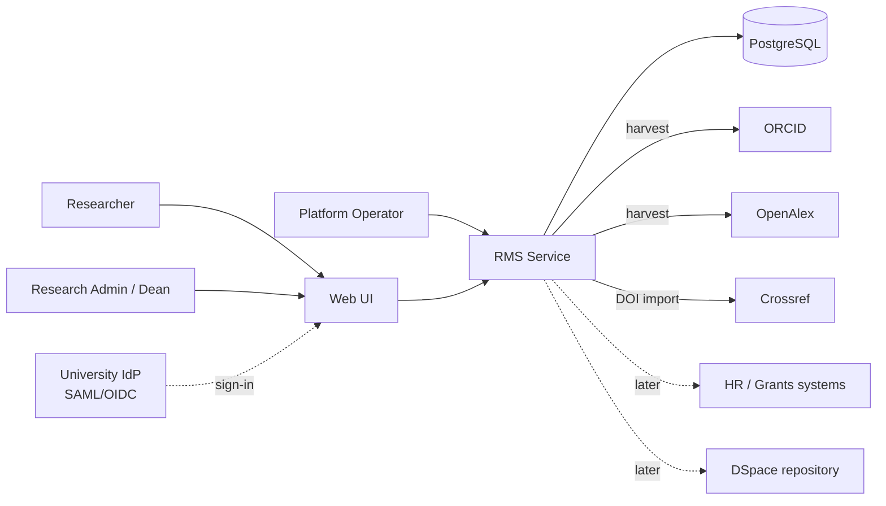

# RMS – System Architecture Document

Status: Draft v0.3 · Companions: PRD.md, TRD.md, FRONTEND_SPEC.md, ACCESS_AND_VISIBILITY_MODEL.md, PRIOR_ART_STUDY.md · Last updated: 2026-11-02
Legend: **[built]** exists in `src/` (not yet compiled or tested), **[planned]** designed but not built.

## 1. Purpose and scope
Describes how RMS is structured, deployed and secured, and why. It is the system-level view; TRD has the detailed requirements and FRONTEND_SPEC the UI. Scope is the multi-tenant research management service for universities (researchers, publications, awards, reports).

## 2. Architectural drivers
| Driver | Source | Consequence |
|---|---|---|
| Strict tenant isolation (a university must never see another's data) | PRD G4 | Tenant derived only from credentials, enforced in every query, then RLS as a second layer |
| Small team, fast pilot | PRD §8 | Modular monolith, one database, no message broker initially |
| Low faculty effort via harvesting | PRD G1 | Background jobs, external API integrations, human verification state |
| Trustworthy reports | PRD G2 | Provenance and verification stored per record; effective-dated affiliations |
| University security reviews | TRD §8 | SSO, audit log, encryption, dependency scanning, pen test |
| Regional data requirements | PRD §6 | Deployable per region; tenant-per-database escape hatch |
| Enterprise buying: SSO, security review, fast onboarding, contract exit | PRD G3, R4, R31–R36 | OIDC in Phase 2, tenant lifecycle component, tenancy ADR 11 |

## 3. Context (C4 level 1)

External systems are reached outbound only, through an allowlist of hosts.

## 4. Containers (C4 level 2)
| Container | Tech | Responsibility | Status |
|---|---|---|---|
| Web UI | React + TypeScript SPA, static files | All user screens | planned |
| RMS Service | Spring Boot 3.3, Java 21 | REST API, auth, business rules, reports | built (API subset) |
| Harvest Worker | Same codebase, separate process/profile | Scheduled and on-demand pulls from ORCID/OpenAlex/Crossref, matching, claim suggestions; also milestone reminders, rollup refresh and period snapshots | planned |
| PostgreSQL 16 | Managed instance | System of record, job queue (`SKIP LOCKED`), audit log | built (schema auto-created) |
| Object storage | S3-compatible | Generated CSV/PDF exports with expiry | planned |
| Ingress / TLS | Reverse proxy or cloud LB | TLS termination, HSTS, rate limiting, serves SPA + `/api` on one origin | planned |
| Platform console | Internal admin UI, same service | Tenant lifecycle (create sandbox or pilot, suspend, export, delete), usage counts, logged support access | planned |

The Service and Worker ship as one image run with different profiles, so there is one codebase and one build.

## 5. Components inside the service
```
 HTTP ──> TenantFilter ──> Controllers ──> Services ──> Repositories ──> PostgreSQL
            (auth→tid)      Crud<T>         (rules,        TenantRepo<T>
                            Reports         validation)    (tenant-scoped)
```
| Component | Role | Status |
|---|---|---|
| TenantFilter | Authenticates the request, resolves tenant id, rejects with 401 otherwise; bootstrap path excluded | built (API key) |
| InstitutionController | Operator-only tenant creation; returns key once, stores SHA-256 hash | built |
| `Crud<T>` + entity controllers | Tenant-scoped list/get/create/update/delete; `prepare()` hook validates cross-references | built |
| PublicationController.import | DOI → Crossref → publication; duplicate and format checks | built |
| Reports | Parameterised tenant-filtered aggregates | built |
| Authz layer (role grants, org-tree scope, supervisor relationships, sensitivity) | Service-level permission checks on every read and write | planned |
| Org tree and appointments | Org units, effective-dated appointments, joint appointments | planned |
| Supervision and milestones | Relationships (incl. backup), milestones, meeting logs, reminders | planned |
| Period close | Snapshots of reported figures per period and org unit | planned |
| Tenant lifecycle | Provisioning, CSV import with preview, sandbox/pilot, suspend, export, delete, per-tenant settings and metering | planned |
| Harvest, Matching, Claims | Source adapters, scoring, claim state machine | planned |
| Export | Async CSV/PDF jobs | planned |
| Audit | Append-only write/export log | planned |

Rule: controllers never call repositories without a tenant id, and entities never accept `institutionId` from clients.

## 6. Data architecture
- **Store:** one PostgreSQL database, shared schema, `institution_id` on every domain table. Table list and planned additions are in TRD §4.
- **Provenance:** each publication keeps its sources and raw payloads; each author link has a claim state (`suggested`, `verified`, `rejected`). Official reports count verified claims only.
- **History:** appointments, role grants and supervision relationships are effective-dated so past reports do not change when people move or leave. Closing a period writes a snapshot, so submitted figures stay fixed.
- **Org tree:** units form a tree inside a tenant (institution → school → department → group). Rollups count each item once at higher levels. Subtree queries use a closure table (or `ltree`). Rollups for unit and executive dashboards are precomputed per unit and period and refreshed by the worker, not aggregated per request.
- **Migrations:** Flyway before any real data (currently `ddl-auto=update`, an MVP shortcut).
- **Reporting at scale:** per-request aggregates now; materialised views refreshed after changes when tenants grow.
- **Retention and deletion:** researcher export/delete for privacy requests; exports expire; audit log retained per contract.

## 7. Key runtime flows
**Tenant request [built]:** client sends key → TenantFilter hashes it, looks up the institution, sets `tid` → controller passes `tid` to the repository → response contains only that tenant's rows. Missing or wrong key: 401. Foreign id: 404 (existence not revealed).

**DOI import [built]:** validate DOI format → reject duplicate for tenant (409) → call Crossref on the fixed host → map title, venue, type, year → save with tenant id → admin links authors later. Crossref failure: 502.

**Harvest and verify [planned]:** scheduler enqueues a job per researcher with an ORCID → worker fetches works from ORCID/OpenAlex with backoff → upserts publications by `(source, external_id)` → matcher creates `suggested` claims with scores → researcher or admin confirms in the Review queue → publication counts in reports.

**Export [planned]:** user requests CSV/PDF → job row created → worker renders from the same queries as the on-screen report → file stored with expiry → UI polls and offers download.

## 8. Security architecture
- **Trust boundary:** everything from clients and external APIs is untrusted; external titles are data, rendered as text.
- **Identity:** now an API key per tenant (hash stored); target OIDC SSO in Phase 2 and SAML in Phase 3, with roles `PLATFORM_ADMIN`, `RESEARCH_ADMIN`, `DEAN`, `RESEARCHER`, `VIEWER`.
- **Isolation, three layers:** (1) tenant id from credential only, (2) repository methods require it, (3) PostgreSQL Row-Level Security via `SET LOCAL app.tenant_id` [planned]. An automated test fails if a table lacks `institution_id` [planned; exemptions listed in TRD §2].
- **Access component:** one place turns the viewer's role grants, mentor relationships and the record's sensitivity into a query condition used by every read. RLS handles tenant isolation only. It is tested for leaks before any scoped endpoint ships.
- **Network:** TLS everywhere; DB not publicly reachable (dev compose binds to localhost); outbound allowlist against SSRF.
- **Secrets:** environment or secret manager only; the application refuses to start the admin endpoint without `RMS_ADMIN_KEY`.
- **Data protection:** encryption at rest (managed disk/DB), minimal personal data, no student data, GDPR export/delete.
- **Detection and assurance:** audit log, structured logs without PII, dependency and secret scanning in CI, external penetration test before first paid customer.

## 9. Deployment architecture
- **Environments:** local (docker compose for Postgres), staging (synthetic data), production per region.
- **Production shape:** LB/ingress → 2+ Service instances (stateless) → managed PostgreSQL with automated backups and point-in-time recovery; Worker as a separate deployment (1+ replicas); object storage bucket for exports.
- **Scaling:** Service scales horizontally (stateless; sessions in cookies/JWT). Worker scales by job concurrency. Database scales vertically first, then read replica for reports. Split Worker/reports into their own services only when measurements justify it.
- **Release:** CI builds and tests, scans dependencies, builds one container image; staging on merge, production by tag; schema migrations run before rollout and are backward compatible.
- **Tenant onboarding:** the operator creates a sandbox or pilot institution, the customer configures OIDC SSO and imports org structure and people by CSV; no per-tenant infrastructure by default, though ADR 11 may change that.

## 10. Quality attributes
| Attribute | Target | Approach |
|---|---|---|
| Isolation | Zero cross-tenant leakage | Three layers (§8), per-endpoint isolation tests |
| Availability | 99.5% pilot, 99.9% paid | Multiple instances, managed DB, health checks |
| Recoverability | RPO ≤ 24 h → ≤ 1 h; RTO ≤ 4 h | Daily backups → PITR; quarterly restore drill |
| Performance | p95 < 500 ms at 5,000 researchers / 200,000 publications | Indexes (TRD §4), pagination, materialised views if needed |
| Maintainability | Small team can run it | One codebase, one DB, generic CRUD, OpenAPI-generated client |
| Observability | Diagnose a tenant issue in minutes | Micrometer/OpenTelemetry, tenant id in logs, harvest dashboards |
| Accessibility | WCAG 2.1 AA | See FRONTEND_SPEC §6 |

Targets are goals to validate by load test, not measured results.

## 11. Decisions (ADR summary)
| # | Decision | Alternatives rejected | Reason |
|---|---|---|---|
| 1 | Greenfield build | Fork VIVO; thin layer over VIVO/DSpace | RDF stack and hosting burden, poor SaaS multi-tenancy |
| 2 | Spring Boot + PostgreSQL | Next.js, Django | Chosen by the product owner; matches the DSpace/VIVO Java ecosystem |
| 3 | Modular monolith | Microservices | Team size; operational simplicity |
| 4 | Shared schema with `institution_id` | Schema or DB per tenant | Cheapest to run; per-tenant DB kept as escape hatch. **Under review, see ADR 11.** |
| 5 | Postgres as job queue | Kafka/RabbitMQ | Fewer moving parts at pilot scale |
| 6 | Human-verified claims | Fully automatic matching | Author disambiguation errors would undermine report trust |
| 7 | Open data sources first (ORCID, OpenAlex, Crossref) | Scopus/WoS first | No licence or key dependency for the pilot |
| 8 | Org tree inside one tenant per customer | Sub-tenant per college | Colleges need delegated admin, not separate isolation; keeps rollups simple |
| 9 | Access = role + scope + sensitivity, checked in the service layer | Role-only; UI-level hiding | Supervisors, HoDs and executives need different slices; UI-only hiding leaks data (VIVO's known flaw) |
| 10 | Milestones and supervision in v1 | Outputs only | Progress tracking is the product goal; a paid market exists for it (PRIOR_ART_STUDY.md) |
| 11 | **Proposed:** schema-per-tenant by default (database-per-tenant for large or in-region customers); shared schema with RLS only for sandbox and pilot tenants | Shared schema for all tenants (ADR 4) | B2B means tens to low hundreds of large tenants. Per-tenant restore, contract-end deletion, data residency and noisy-neighbour control are simple per schema and hard in a shared one. Cost: migrations run per schema. **Status: proposed. ADR 4 stands until the first customer conversation decides it.** |
| 12 | OIDC SSO in Phase 2, SAML in Phase 3 | Email links until Phase 3 | University IT will not approve email-link login for real staff |
| 13 | Tenant lifecycle is a first-class component | Operator scripts | Onboarding in two weeks, sandbox-to-paid conversion and suspend/export/delete are sales and contract needs |

## 12. Risks and open items
- Single shared database is a blast-radius risk; mitigate with RLS, backups, and the per-tenant DB option. Restoring or deleting a single tenant is hard in a shared schema; ADR 11 proposes schema-per-tenant for that reason.
- Harvest quality and rate limits of external APIs; mitigate with caching, backoff, and raw payload retention.
- The MVP has never been built or tested in this environment; verify before relying on any of the above.
- Open: hosting provider and region (and whether the first customer accepts shared hosting); whether the first customer needs SAML before Phase 3; SPA chosen in RMS_FRONTEND_ARCHITECTURE.md, confirm; data-source licensing beyond open sources; whether public profile pages are in scope for the first customer.
