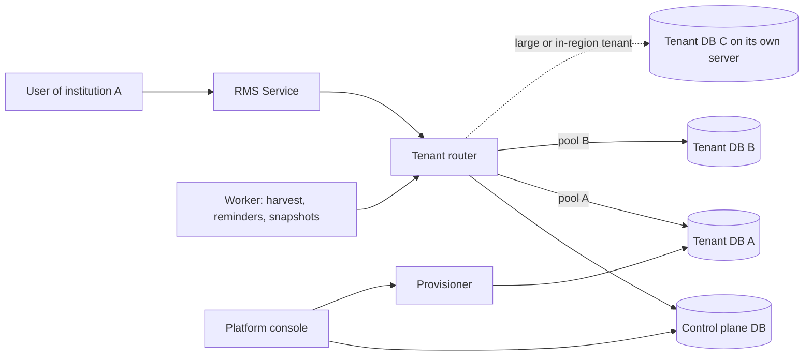

# RMS – Multi-Tenancy Design: a database per institution

Status: Draft v0.1 · Companion to ARCHITECTURE.md (ADR 4, 11), TRD.md (§2, §4, §9a) and PRD.md (R1, R31–R36) · Last updated: 2026-11-03
Nothing in this document is built. The MVP described in the TRD uses a shared schema with `institution_id`; this design replaces it.

## 1. Decision
Every institution (tenant) gets its **own PostgreSQL database**. A small **control-plane database** records which institutions exist and where their database lives. There is no `institution_id` filtering inside tenant data, because the database is the tenant boundary.

Why, for a B2B product with tens to low hundreds of large customers:
- A leak across institutions is impossible by construction, not by every query remembering a filter.
- Restoring, exporting or deleting one institution is an operation on one database.
- A customer that needs data in a specific region, or on its own server, gets its own database server without code changes.
- One large tenant cannot slow the others' tables, indexes or backups.

What it costs: more databases to migrate, back up and monitor, and more database connections. Section 9 lists the mitigations. This stops being the right design somewhere around thousands of tenants, which is far from the expected scale.

## 2. Parts

| Part | Responsibility |
|---|---|
| **Control plane DB** | The institution registry, plans, status and schema versions, platform admin users, usage counters, the platform access log. Holds no research data. |
| **Tenant database** | The whole RMS schema (TRD §4) for one institution, plus its own Flyway history. |
| **Tenant router** | Maps the request's tenant to a connection pool and hands the repository layer a connection to that tenant's database only. |
| **Provisioner** | Creates and prepares a tenant database (section 5). |
| **Migrator** | Applies schema changes to every tenant database (section 6). |
| **Secrets store** | AWS Secrets Manager: one secret per tenant database login. |

## 3. Control-plane data
| Table | Fields |
|---|---|
| `institution` | id, slug (used in the database name), name, status `[sandbox, pilot, active, suspended, closing, closed]`, plan, region, `db_host`, `db_port`, `db_name`, `secret_arn`, `schema_version`, `created_at`, `closed_at` |
| `institution_credential` | institution_id, key_hash (for the API-key path), created_at, revoked_at |
| `platform_user` | platform operators and their roles |
| `usage_counter` | institution_id, month, active_researchers |
| `migration_run` | institution_id, from_version, to_version, started_at, finished_at, status, error |
| `platform_access_log` | actor, action, institution_id, reason, at (support access and tenant lifecycle actions) |

Each tenant database keeps one `institution` row of its own (name, locale, currency, fiscal year, branding) so a restored dump is self-describing.

## 4. How a request reaches the right database
1. The user signs in through their institution's SSO (or API key). The tenant is derived **only from the credential**; nothing the client sends can pick the tenant. A subdomain such as `<slug>.unirise…` may help route sign-in, but it is never trusted on its own.
2. The router reads the institution from the control plane (cached for a short time, with the status check: a suspended or closed tenant is refused with a clear error).
3. It gets or creates that tenant's pool (section 9) and binds it to the request. In Spring Boot this is Hibernate's database-per-tenant mode: a `CurrentTenantIdentifierResolver` reads the tenant from a request-scoped context, and a `MultiTenantConnectionProvider` returns a connection from that tenant's pool.
4. The service layer still asserts that every record belongs to the signed-in tenant (the institution row's id in the token must match). It is a second guard, not the boundary.
5. Responses never reveal whether another tenant exists. A foreign id is a plain 404, as today.

Rules that keep this safe:
- The tenant context is set at one place (the filter) and cleared in `finally`.
- **Background work and async tasks carry the tenant explicitly.** No tenant-less code path may reach a tenant database. Worker jobs loop over tenants and set the context for each.
- **Caches are keyed by tenant id**, including in-memory ones. Anything cached without the tenant id is a leak.
- Logs and metrics carry the tenant id and no personal data.

## 5. Provisioning a tenant (PRD R31, R32)
An idempotent, resumable job with a visible status in the platform console:
1. Insert the control-plane row with status `provisioning`.
2. Create the database `tenant_<slug>` and a **dedicated application role** with only the privileges it needs (no superuser, no `CREATE DATABASE`). Optionally a read-only reporting role.
3. Store the credentials in Secrets Manager (`unirise/<env>/tenants/<slug>`), and write the secret ARN to the control plane.
4. Run all Flyway migrations, then seed the starter data: built-in roles, a root org unit, default classification lists.
5. Create the first admin from the invitation and configure OIDC.
6. Set the status to `sandbox` or `pilot` and the schema version.

If a step fails the job stops with its state recorded. Retrying resumes from that step; a **cleanup** action drops a half-created database and its secret. A sandbox or pilot tenant converts to `active` by changing its status, with no data migration.

## 6. Schema migrations across all tenants
- One Flyway migration set for the tenant schema, applied **per database**. The control plane has its own set.
- The Migrator runs as a deploy step before the new application version takes traffic, with a small concurrency limit (for example 4 tenants at a time).
- Order: the sandbox tenant first as a canary, then the rest in batches. **One tenant failing does not block the others**; it is marked `migration_failed` in `migration_run` and the platform operator is alerted.
- Changes are **backward-compatible (expand, then contract)**: add columns and tables first, remove old ones in a later release. The application must work against version N and N-1 so that a rollout can finish gradually.
- Each request checks that its tenant's `schema_version` is one the running application supports; otherwise it returns a maintenance response for that tenant only.
- A migration that rewrites a large table runs as a background job, not inside the deploy step.

## 7. Where the databases live
| Option | When | Notes |
|---|---|---|
| **Many tenant databases on one shared RDS instance** | Default: sandbox, pilot and most customers | Cheapest. Watch `max_connections` (section 9) and noisy neighbours. |
| **A dedicated RDS instance for one tenant** | Large customers, contractual isolation, a specific region | The control plane points to another `db_host`. No code change. Own backups and encryption key. |
| **A different AWS region** | Data-residency requirements | The tenant's database, files and secrets live in that region; the control plane stays central, and only registry data crosses regions. |

Moving a tenant between servers: put the tenant in `closing` (read-only), `pg_dump` and restore to the new server, verify counts, switch `db_host`, then drop the old copy after a retention window.

## 8. Backup, restore, export and deletion (PRD R33)
- **Backups.** RDS automated backups and point-in-time recovery protect the whole instance (disaster recovery). They cannot restore one database on their own without restoring the entire instance first.
- **Per-tenant backups.** A nightly `pg_dump` of each tenant database to S3 under `backups/<slug>/`, encrypted, with a lifecycle rule. Restoring one tenant is: create a fresh database, restore the dump, then switch the control plane pointer. **Rehearse restores on a schedule**; an untested backup is not a backup.
- **Export (contract exit).** Full data in open formats (CSV and JSON) plus the original uploaded files, delivered through a time-limited link, with a record of who requested it.
- **Deletion.** Order: export delivered, tenant set to `closing` (read-only), retention period (agreed in the contract, for example 30 days), then drop the database, delete the Secrets Manager secret, delete the S3 prefix (and the tenant's encryption key if it has one), and write a **deletion record** to the platform access log. Never reuse a slug.

## 9. Connections and capacity
- Each tenant has its own pool, created on first use. Typical settings: maximum 5 connections, minimum idle 0, idle timeout a few minutes, so unused tenants hold no connections.
- A **global cap** on total connections per application instance, and an LRU eviction of the least recently used pools when the cap is reached.
- A small RDS instance allows only tens to a couple of hundred connections, so size `max_connections` against `instances × pools × pool size`. Put **RDS Proxy or PgBouncer** in front once the totals approach the limit.
- PostgreSQL handles hundreds of databases on one instance, but catalog size, autovacuum and backup time grow with it. Plan to move large or busy tenants to their own instance rather than fill one server.
- **Monitor per tenant:** pool wait time, slow queries, database size, migration status.

## 10. Cross-tenant questions
- No query spans tenants. Platform operations use the control plane only (counts, status, usage).
- If benchmarking between institutions is ever offered, each tenant **publishes anonymised aggregates** (counts and distributions, no names) to the control plane on a schedule, and the customer must opt in by contract.

## 11. Security
- One database login per tenant, with no access to other databases. The runtime role is not a superuser and cannot create roles or databases.
- Credentials only in Secrets Manager, rotated on a schedule; connection strings never appear in logs.
- Databases are private (no public access), encrypted at rest, and reachable only from the application and the provisioner.
- Platform support access to a tenant is break-glass, time-limited, and logged in `platform_access_log` (PRD R5, R27).
- The platform console and the provisioner use separate privileges from the runtime application.

## 12. Testing
- **Isolation test:** a user of tenant A cannot read or write tenant B's data through any endpoint, including by guessing ids; a request with a missing or foreign tenant fails closed.
- **No tenant-less path:** a test that background jobs and async tasks fail if no tenant context is set.
- **Provisioning:** idempotent re-runs, failure at each step, and cleanup.
- **Migration:** a failing migration on one tenant leaves the others migrated; the N and N-1 compatibility check works.
- **Pool eviction** under the global cap, and cache keys include the tenant.
- **Restore drill** in staging at least once per quarter.

## 13. Development environment (infra/)
- The shared dev RDS instance (Terraform in `infra/`) holds several databases: `unirise_control` and one per test tenant (`tenant_demo`, `tenant_sandbox`). **The application creates tenant databases, not Terraform.**
- Local Docker (PostgreSQL 16) works the same way: a control-plane database plus test tenant databases.
- Not yet in `infra/`: a Secrets Manager path and IAM policy for tenant credentials (`unirise/dev/tenants/*`), an S3 prefix per tenant, and RDS Proxy.

## 14. Effect on the other documents
| Document | Change |
|---|---|
| ARCHITECTURE | ADR 4 superseded; ADR 11 accepted; control plane and tenant router added; the "three layers" isolation model changes |
| TRD §2 | Multi-tenancy rewritten: no `institution_id` filtering, no RLS for tenants |
| TRD §4 | `institution` moves to the control plane; per-table `institution_id` is dropped in tenant databases |
| TRD §9a, §10 | Backup, restore and migrations are per tenant database |
| PRD | R1 states the database-per-tenant rule; the open tenancy question is closed |

## 15. Open questions and risks
| Item | Note |
|---|---|
| Connection pooling product | RDS Proxy (managed, per-region cost) or PgBouncer (self-run). Decide when load tests show the limit. |
| Tenants per RDS instance | Set a threshold (for example 50) after measuring catalog and backup growth. |
| Database naming | `tenant_<slug>` with a validated slug, never user-supplied text in SQL; use quoted identifiers. |
| Shared reference data | Journal lists and classification lists are copied per tenant at provisioning; decide how updates reach every tenant. |
| Migration speed at scale | Hundreds of tenants take time to migrate; keep the concurrency limit configurable and the migrations fast. |
| Risk: a code path without tenant context | The main way this design can still leak. Mitigated by the filter, the tests in section 12 and code review. |
| Risk: backup restore not rehearsed | Schedule drills. |
| Risk: connection exhaustion | Small pools, global cap, eviction and a proxy. |
