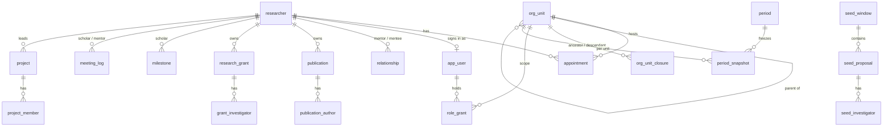

# RMS – Tenant database schema

Status: matches the code as built · Source of truth: Flyway migrations `V1` to `V5` in `unirise-api/src/main/resources/db/tenant/` · Last updated: 2026-11-03
Companion to MULTI_TENANCY_DESIGN.md and TRD.md §4. Where this file and TRD §4 differ, this file is the current design: TRD §4 still describes the earlier shared-schema model.

Each institution has its own PostgreSQL database, named `tenant_<slug>`. Tables carry **no `institution_id`**, because the database is the tenant boundary. The control-plane database (institution registry, API key hashes, tokens, migration history, usage) is separate and holds no research data; see MULTI_TENANCY_DESIGN.md §3.

`PK` is a primary key and `FK` a foreign key. Flyway also adds its own `flyway_schema_history` table, which the contract-exit export leaves out.

## 1. Overview

## 2. People and structure

### institution
One row describing this tenant, so a restored dump is self-describing.

| Column | Type | Notes |
|---|---|---|
| id | SMALLINT PK | Always 1 (check constraint) |
| name | TEXT | |
| locale | TEXT | Default `en-IN` |
| currency | TEXT | Default `INR` |
| fiscal_start | SMALLINT | Default 4 (April) |

### researcher
The general person record: faculty, scholar, staff or guest.

| Column | Type | Notes |
|---|---|---|
| id | BIGSERIAL PK | |
| name | TEXT | Required |
| email | TEXT | |
| orcid | TEXT | Unique where set |
| employee_id | TEXT | Unique where set |
| scopus_id | TEXT | Unique where set |
| roll_no | TEXT | Unique where set (students) |
| is_scholar | BOOLEAN | Default false |
| created_at | TIMESTAMPTZ | |

### org_unit
| Column | Type | Notes |
|---|---|---|
| id | BIGSERIAL PK | |
| parent_id | BIGINT FK → org_unit | Null for a root |
| type | TEXT | `campus`, `school`, `department`, `group` |
| name | TEXT | |

### org_unit_closure
One row per (ancestor, descendant) pair, including each unit with itself at depth 0. Makes "everything under this unit" a single join.

| Column | Type | Notes |
|---|---|---|
| ancestor_id | BIGINT FK → org_unit | PK with descendant_id |
| descendant_id | BIGINT FK → org_unit | Indexed |
| depth | INT | |

### appointment
Effective-dated; supports joint appointments.

| Column | Type | Notes |
|---|---|---|
| id | BIGSERIAL PK | |
| researcher_id | BIGINT FK → researcher | |
| org_unit_id | BIGINT FK → org_unit | |
| designation | TEXT | |
| fte | NUMERIC(3,2) | Default 1 |
| valid_from | DATE | Default today |
| valid_to | DATE | Null while current |

## 3. Access

### app_user
Login identity only. What a user may do comes from `role_grant` and relationships.

| Column | Type | Notes |
|---|---|---|
| id | BIGSERIAL PK | |
| email | TEXT | Unique |
| researcher_id | BIGINT FK → researcher | Optional |
| active | BOOLEAN | Default true |

### role_grant
| Column | Type | Notes |
|---|---|---|
| id | BIGSERIAL PK | |
| app_user_id | BIGINT FK → app_user | |
| role | TEXT | `RESEARCH_ADMIN`, `IT_ADMIN`, `EXECUTIVE`, `DEAN`, `HOD`, `VIEWER` |
| scope_unit_id | BIGINT FK → org_unit | Null means the whole institution |
| valid_from / valid_to | DATE | Time-bound, supports acting roles |
| granted_by | BIGINT | The granting user |

Supervisor and researcher access is not a grant: it comes from the linked researcher and from `relationship`.

### relationship
| Column | Type | Notes |
|---|---|---|
| id | BIGSERIAL PK | |
| mentor_id | BIGINT FK → researcher | |
| mentee_id | BIGINT FK → researcher | A person cannot mentor themselves |
| type | TEXT | `primary`, `co`, `backup` |
| valid_from / valid_to | DATE | |

### access_log
Named drill-downs by a Dean or Executive.

| Column | Type | Notes |
|---|---|---|
| id | BIGSERIAL PK | |
| actor_user_id | BIGINT | |
| action | TEXT | For example `view.person` |
| target_researcher_id | BIGINT | |
| at | TIMESTAMPTZ | |

## 4. Publications

### publication
| Column | Type | Notes |
|---|---|---|
| id | BIGSERIAL PK | |
| title | TEXT | Required |
| doi | TEXT | Unique, case-insensitive, where set |
| venue | TEXT | |
| type | TEXT | `journal-article`, `conference-paper`, `book-chapter`, `book`, `technical-report`, `preprint`, `patent` |
| pub_year | INT | 1900 to 2100 |
| pub_month | INT | 1 to 12 |
| issn, category | TEXT | |
| project_ref | BOOLEAN | Default false |
| project_details | TEXT | |
| student_publication | BOOLEAN | Default false |
| entry_status | TEXT | `draft`, `submitted`, `approved`, `rework`, `revision_required`, `rejected` |
| review_comment | TEXT | |
| owner_id | BIGINT FK → researcher | Indexed |
| version | INT | Optimistic lock |
| created_at | TIMESTAMPTZ | |

### publication_author
| Column | Type | Notes |
|---|---|---|
| id | BIGSERIAL PK | |
| publication_id | BIGINT FK → publication | Deletes with the publication |
| position | INT | Author order |
| researcher_id | BIGINT FK → researcher | Null for outside authors |
| kind | TEXT | `internal-faculty`, `internal-student`, `external`, `ex-faculty`, `ex-student` |
| name | TEXT | |
| institution, department, email, continent | TEXT | |
| end_date | DATE | Termination or course completion for ex-members |

## 5. Grants

### research_grant
| Column | Type | Notes |
|---|---|---|
| id | BIGSERIAL PK | |
| unit, type, source | TEXT | |
| status | TEXT | `draft`, `submitted`, `sanctioned`, `rework`, `rejected` |
| utn, title, description, call_title, agency, agency_comment | TEXT | Title required |
| applied_on, entered_on, sanctioned_on | DATE | `entered_on` defaults to today |
| applied_amount | NUMERIC(14,2) | Not negative |
| sanctioned_amount | NUMERIC(14,2) | Not negative |
| duration_months | INT | |
| matching_grant | BOOLEAN | |
| remarks, review_comment | TEXT | |
| owner_id | BIGINT FK → researcher | Indexed |
| version | INT | Optimistic lock |

### grant_investigator
| Column | Type | Notes |
|---|---|---|
| id | BIGSERIAL PK | |
| grant_id | BIGINT FK → research_grant | Cascade delete |
| researcher_id | BIGINT FK → researcher | Null for outside investigators |
| name | TEXT | |
| role | TEXT | `PI`, `Co-PI`, `Collaborator` |
| is_lead | BOOLEAN | Exactly one lead is required to submit |
| institution, department | TEXT | |
| share_pct | NUMERIC(5,2) | 0 to 100; shares must total 100 to submit |

## 6. Seed money

### seed_window
| Column | Type | Notes |
|---|---|---|
| id | BIGSERIAL PK | |
| label | TEXT | |
| opens_on / closes_on | DATE | `closes_on` is not before `opens_on` |

New proposals are accepted only while a window is open; the server returns 409 otherwise.

### seed_proposal
| Column | Type | Notes |
|---|---|---|
| id | BIGSERIAL PK | |
| window_id | BIGINT FK → seed_window | |
| category, title, abstract | TEXT | Title required |
| status | TEXT | `draft`, `submitted`, `approved`, `rework`, `revision_required`, `rejected` |
| applied_on | DATE | Default today |
| review_comment | TEXT | |
| owner_id | BIGINT FK → researcher | |
| version | INT | Optimistic lock |

### seed_investigator
| Column | Type | Notes |
|---|---|---|
| id | BIGSERIAL PK | |
| proposal_id | BIGINT FK → seed_proposal | Cascade delete |
| researcher_id | BIGINT FK → researcher | Optional |
| name, investigator_type, institution, department | TEXT | |
| is_lead_pi | BOOLEAN | Exactly one lead PI is required to submit |

### review_event
Workflow history for publications, grants and seed proposals.

| Column | Type | Notes |
|---|---|---|
| id | BIGSERIAL PK | |
| entity_type | TEXT | `publication`, `grant`, `seed` |
| entity_id | BIGINT | Indexed with entity_type |
| action | TEXT | `submit`, `approve`, `rework`, `revision_required`, `reject` |
| actor_user_id | BIGINT | |
| comment | TEXT | Required for every action except approve |
| at | TIMESTAMPTZ | |

## 7. Supervision and progress

### milestone
| Column | Type | Notes |
|---|---|---|
| id | BIGSERIAL PK | |
| scholar_id | BIGINT FK → researcher | Indexed |
| stage | TEXT | Free text; the UI suggests common stages |
| due_date | DATE | |
| completed_at | DATE | Set by the scholar or a supervisor |
| approved_by | BIGINT FK → researcher | Never the scholar |
| approved_on | DATE | |
| feedback | TEXT | |

Status (done, upcoming, overdue) is computed from the dates, not stored.

### meeting_log
Confidential: readable only by the scholar and their active supervisors. It is never part of any rollup, report or admin view.

| Column | Type | Notes |
|---|---|---|
| id | BIGSERIAL PK | |
| scholar_id | BIGINT FK → researcher | Indexed |
| mentor_id | BIGINT FK → researcher | The author |
| held_on | DATE | |
| notes | TEXT | |

### project and project_member
| Table | Columns |
|---|---|
| project | `id` PK, `title`, `lead_id` FK → researcher, `status` (`active`, `completed`, `proposed`), `summary`, `sensitivity` (`internal`, `confidential`) |
| project_member | `project_id` FK (cascade), `researcher_id` FK. PK is the pair. |

A confidential project is shown in full only to its lead, members and admins. Everyone else gets a "Restricted" placeholder.

### tenant_settings
One row: `id` (always 1), `escalation_days` (default 30, range 1 to 365), the number of days overdue after which a milestone reminder also goes to the head of department.

## 8. Reporting

### period
| Column | Type | Notes |
|---|---|---|
| id | BIGSERIAL PK | |
| label | TEXT | |
| starts_on / ends_on | DATE | |
| closed_at | TIMESTAMPTZ | Null while open; a period closes once |
| closed_by | BIGINT | |

### period_snapshot
Figures frozen when a period closes, so reported numbers stop moving.

| Column | Type | Notes |
|---|---|---|
| period_id | BIGINT FK → period | PK with the two below |
| org_unit_id | BIGINT FK → org_unit | |
| metric | TEXT | `researchers`, `publications`, `grants`, `sanctioned_amount` |
| value | NUMERIC(16,2) | |

## 9. Conventions
- **Effective dating:** appointments, role grants and relationships use `valid_from` and `valid_to`. "Current" means valid today.
- **Workflow:** publications, grants and seed proposals share the draft, submit, review flow. An approved publication or a sanctioned grant counts in reports; drafts, reworks and rejections do not.
- **Optimistic locking:** `version` on publications, grants and seed proposals; an update against an old version returns 409.
- **Visibility is not in the schema.** It is enforced in the service layer from role grants, scope and relationships (ACCESS_AND_VISIBILITY_MODEL.md), and checked on every read and write.
- **Not yet in the schema:** attachments (PDF uploads), classification schemes, authorship claims and duplicate handling, webhooks and harvest runs.
