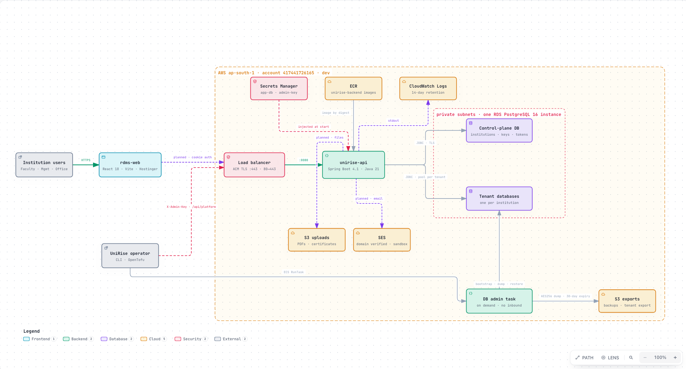

# unirise-api

Spring Boot 4 / Java 21 backend for UniRise. One database per institution; a control-plane database tracks them
(see `rms-docs/MULTI_TENANCY_DESIGN.md`).

## Architecture


Solid lines are deployed in dev. Dashed lines and "planned" tags are designed but not built. Open
[`rms-docs/architecture/unirise-system.html`](../rms-docs/architecture/unirise-system.html) in a browser for the interactive version
with detail cards (frontend, API built and planned, tables, security, operations). Its source is `unirise-system.archify.json` beside it.

- **Request path:** institution users → `rdms-web` (React, to be hosted on Hostinger) → HTTPS load balancer → `unirise-api` on ECS Fargate → one control-plane database and one database per institution on a private RDS PostgreSQL 16 instance.
- **Around the API:** Secrets Manager (database password, operator key), ECR (image pinned by digest), CloudWatch Logs. S3 uploads and SES exist in AWS but the API does not use them yet.
- **Operator path:** `/api/platform/**` with `X-Admin-Key`, and an on-demand Fargate admin task for database bootstrap, backup and restore (`scripts/run-db-admin.sh`), which writes encrypted dumps to the S3 exports bucket.
- **Not connected yet:** no `rdms-web` screen calls this API. The frontend still runs on its own Node/SQLite prototype server.

The stack, the gaps between the frontend and this API, the AWS state, the phased plan and the decisions are in
[`rms-docs/BACKEND_PLAN.md`](../rms-docs/BACKEND_PLAN.md).

## Run and test
```bash
export JAVA_HOME=~/.jdks/temurin21/Contents/Home        # any JDK 21
./mvnw verify                                            # needs Docker: the tests start PostgreSQL 16 with Testcontainers
docker compose --profile api up --build                  # from the repo root, after copying .env.example to .env
```
The API listens on `127.0.0.1:8081` in compose. Create an institution with the operator key:
`POST /api/platform/tenants` with header `X-Admin-Key: <RMS_ADMIN_KEY>` and body `{"slug":"demo","name":"Demo University"}`.
The response holds that institution's API key, shown once.

## Configuration (environment)
| Variable | Meaning |
|---|---|
| `CONTROL_DB_URL`, `CONTROL_DB_USER`, `RMS_DB_PASSWORD` | Control-plane database. The login must be able to create roles and databases. |
| `TENANT_DB_HOST`, `TENANT_DB_PORT` | Server where new institution databases are created. |
| `RMS_ADMIN_KEY` | Operator key for `/api/platform/**`. The endpoints are disabled when it is empty. |
| `TENANT_RETENTION_DAYS` | Days an institution stays in `closing` before its database may be dropped (default 30). |

## Known shortcuts (each has a `shortcut:` note in the code or docs)
Institution database passwords sit in a control-plane table (replace with Secrets Manager before real data), invitation tokens are returned
to the admin instead of emailed, sign-in is API key or invitation only (OIDC is next), reports export CSV only, and webhooks and the
publication harvester are not built.
