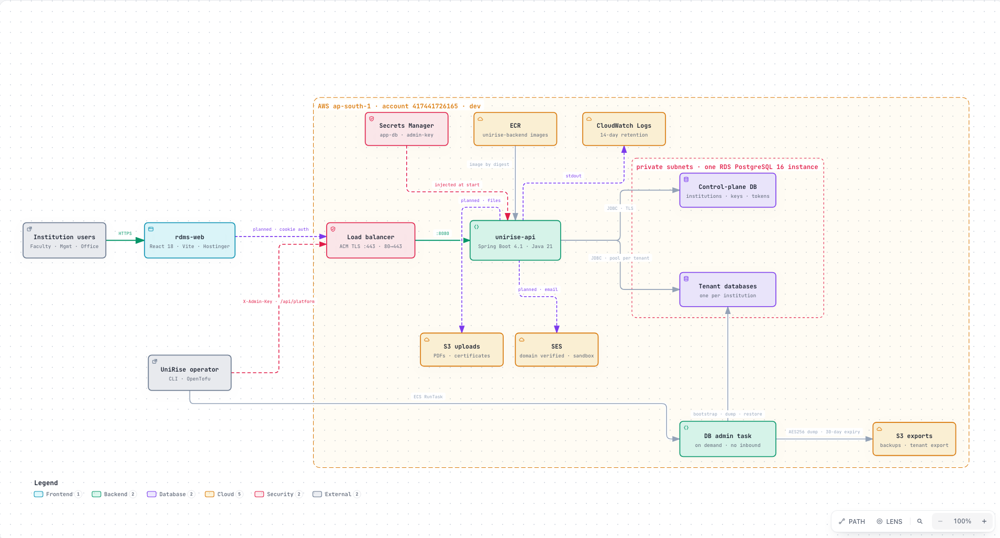

# unirise-api

Spring Boot 4 / Java 21 backend for UniRise. One database per institution; a control-plane database tracks them
(see `rms-docs/MULTI_TENANCY_DESIGN.md`).

## Architecture


Solid lines are deployed in dev. Dashed lines and "planned" tags are designed but not built. Open
[`rms-docs/architecture/unirise-system.html`](../rms-docs/architecture/unirise-system.html) in a browser for the interactive version
with detail cards (frontend, API built and planned, tables, security, operations). Its source is `unirise-system.archify.json` beside it.

- **Request path:** institution users → `rdms-web` (React, to be hosted on Hostinger) → HTTPS load balancer → `unirise-api` on ECS Fargate → one control-plane database and one database per institution on a private RDS PostgreSQL 16 instance.
- **Around the API:** Secrets Manager (database password, operator key), ECR (image pinned by digest), CloudWatch Logs. S3 uploads and SES exist in AWS but the API does not use them yet.
- **Operator path:** `/api/platform/**` with `X-Admin-Key`, and an on-demand Fargate admin task for database bootstrap, backup and restore (`scripts/run-db-admin.sh`), which writes encrypted dumps to the S3 exports bucket.
- **Not connected yet:** no `rdms-web` screen calls this API. The frontend still runs on its own Node/SQLite prototype server.

The stack, the gaps between the frontend and this API, the AWS state, the phased plan and the decisions are in
[`rms-docs/BACKEND_PLAN.md`](../rms-docs/BACKEND_PLAN.md).

## Run and test
```bash
export JAVA_HOME=~/.jdks/temurin21/Contents/Home        # any JDK 21
./mvnw verify                                            # needs Docker: the tests start PostgreSQL 16 with Testcontainers
docker compose --profile api up --build                  # from the repo root, after copying .env.example to .env
```
With **Colima** instead of Docker Desktop (macOS), point Testcontainers at it and keep temporary files under your home
folder, which is the only folder Colima shares with its containers (the backup test mounts one):
```bash
export DOCKER_HOST=unix://$HOME/.colima/default/docker.sock TESTCONTAINERS_DOCKER_SOCKET_OVERRIDE=/var/run/docker.sock
mkdir -p ~/.cache/unirise-test-tmp && ./mvnw verify -DargLine="-Djava.io.tmpdir=$HOME/.cache/unirise-test-tmp"
```
The API listens on `127.0.0.1:8081` in compose. Create an institution with the operator key:
`POST /api/platform/tenants` with header `X-Admin-Key: <RMS_ADMIN_KEY>` and body
`{"slug":"demo","name":"Demo University","officeEmail":"office@demo.example"}`.
The response holds that institution's API key and the first Office of Research account's temporary password, each shown once.

## Sign-in and roles (phase 2)
- Three roles (`office`, `management`, `faculty`), stored on `app_user` in each institution's database. Only the Office of
  Research reviews and administers; Top-Level Management is read-only and only ever sees approved entries; faculty see
  their own work and work they are credited on.
- Email and password sign-in: `POST /api/login`, `POST /api/admin/login` (Office only), `POST /api/logout`,
  `GET /api/session`, `POST /api/account/password`. Same requests and responses as the rdms-web prototype server.
  The control plane's `account_login` maps an email to its institution, so the tenant still comes only from the credential.
- Session: an `HttpOnly; SameSite=Strict; Secure` cookie (`unirise_sid`); only its hash is stored. 8 hours idle (30 minutes
  for the Office), 12 hours at most; ended on sign-out, password change, suspension, role change and password reset.
- Every change from a browser needs the header `X-RDMS: 1` (cross-site request forgery). Five failed sign-ins per email
  or twenty per client address lock that key for 15 minutes, counted in the database.
- User management for the Office: `GET/POST /api/office/users`, `POST /api/office/users/{id}/status|role|reset-password`,
  and the audit log `GET /api/office/audit`.
- The institution's API key (`X-API-Key`) still works for integrations and acts as the Office of Research.
- Parked by decision D3 (tables kept, endpoints answer 404): milestones, meeting logs, reminders, projects, periods,
  relationships, role grants and the old invitation sign-in.

## Institution data (phases 3 to 5): the API the frontend uses
Same requests and responses as the rdms-web prototype server, so `rdms-web` works against this API unchanged
(set `VITE_API_BASE` when the API has its own address).
- `GET /api/data`: everything the caller may see, in the UI's `DB` shape (decision D2: the browser computes reports and
  analytics). Office: everything; management: current faculty and approved records that credit them, without review
  comments; faculty: their own profile and records. Answers `304` to an unchanged `If-None-Match`.
- Entries of seven kinds: `POST /api/records/{kind}` (`{record, submit}`), `DELETE /api/records/{kind}/{id}` (drafts).
  Stored in `record` as the UI's JSON with typed columns for owner, status and credited faculty; display ids come from
  one counter per institution (PUB1001, GRT1002, ...).
- Review by the Office: `GET /api/office/approvals?view=awaiting|review|returned|approved|rejected`, `/count`,
  `POST .../{kind}/{id}/start`, `.../review` (`Approved`, `Rework` with a comment, `Rejected` with a reason),
  `.../grants/{id}/outcome`, and the same for profile updates under `.../profiles/{id}`.
- Profiles: `POST /api/profile-changes` (faculty propose, the Office approves), `PUT /api/faculty/{id}` (official details,
  former faculty with reason and last working day), `PUT /api/settings`, `POST/DELETE /api/notices`, `POST /api/enquiries`.
- Operator: `POST /api/platform/tenants/{slug}/demo-data` loads data in the UI's shape and demo accounts into an empty
  sandbox institution (`rdms-web/scripts/export-demo.ts` produces it).

To run the website against this API locally: start the API, then in `rdms-web` run `npm run build` and
`API=http://127.0.0.1:8081 node scripts/api-proxy.mjs`, which serves the pages and forwards `/api` on one origin.

CORS allows `https://dev-unirise.mentoredge.co.in` on `/api/**`, including preflight requests. API calls still need their
normal credentials. Other browser origins are rejected. `TenantIsolationTest` checks preflight, origin rejection and missing-key behaviour.

## Configuration (environment)
| Variable | Meaning |
|---|---|
| `CONTROL_DB_URL`, `CONTROL_DB_USER`, `RMS_DB_PASSWORD` | Control-plane database. The login must be able to create roles and databases. |
| `TENANT_DB_HOST`, `TENANT_DB_PORT` | Server where new institution databases are created. |
| `RMS_ADMIN_KEY` | Operator key for `/api/platform/**`. The endpoints are disabled when it is empty. |
| `TENANT_RETENTION_DAYS` | Days an institution stays in `closing` before its database may be dropped (default 30). |

## Known shortcuts (each has a `shortcut:` note in the code or docs)
Institution database passwords sit in a control-plane table (replace with Secrets Manager before real data), temporary passwords are
shown to the Office of Research instead of emailed (SES is not wired yet), sign-in is email and password (OIDC is phase 8), reports export
CSV only, and webhooks and the publication harvester are not built.
